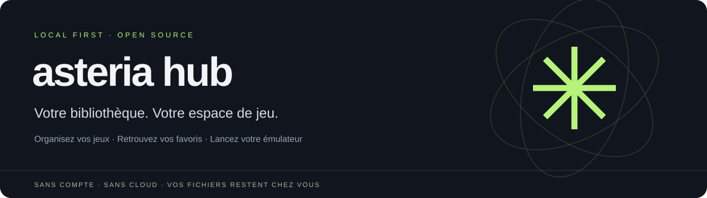
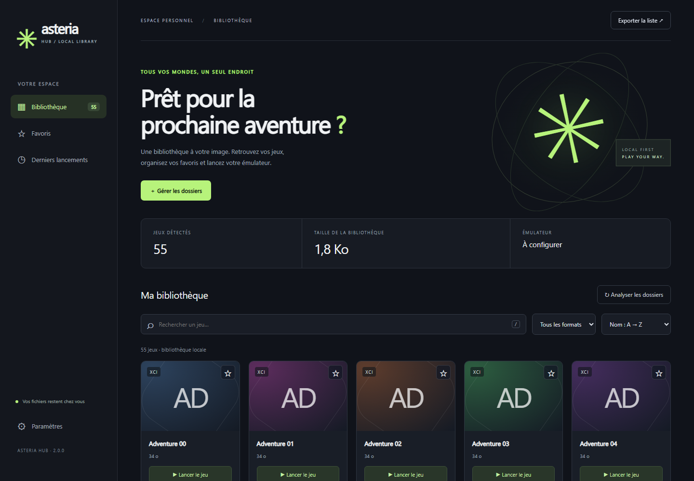

# Asteria Hub



**Your games, your favorites, your emulator — in one local library.**

[Download for Windows](https://github.com/mathix03/asteria-hub/releases/latest) · [Français](README.md) · [Report an issue](https://github.com/mathix03/asteria-hub/issues)

Asteria Hub is an independent, open source desktop companion designed for use with Eden. It indexes your existing files and sends launch commands to your chosen emulator. No account, cloud storage or telemetry is required.



## Features

- Scan multiple folders recursively and avoid duplicate entries for overlapping folders.
- Find NSP, XCI, NSZ and NRO files. Actual format support depends on your emulator.
- Search without worrying about accents; combine search, format filters and favorites.
- Sort by name, size, modification time or most recent launch.
- Keep favorites and launch history between sessions.
- Display local cover images: place `My game.png`, `.jpg`, `.jpeg` or `.webp` beside `My game.nsp`.
- Export library metadata to JSON without absolute file paths.
- Use a responsive interface with keyboard navigation and `/` to search.
- Run entirely on your computer, with the server bound to `127.0.0.1`.

## Windows download

Download the Windows ZIP from [Releases](https://github.com/mathix03/asteria-hub/releases/latest), extract it and run `AsteriaHub.exe`. Python is not required for the packaged application. Keep the console open while using the app; close it or press Ctrl+C to stop.

Open **Paramètres**, enter the full path to your emulator executable, then add one game folder per line. Select **Enregistrer et analyser** to build your library. The current interface is in French.

## Run from source

Requires Python 3.11 or newer. From the project directory on Windows:

```powershell
py -3 -m venv .venv
.\.venv\Scripts\python.exe -m pip install -r requirements.txt
.\.venv\Scripts\python.exe main.py
```

On Linux or macOS:

```sh
python3 -m venv .venv
.venv/bin/python -m pip install -r requirements.txt
.venv/bin/python main.py
```

On macOS, select the executable inside the emulator's `.app/Contents/MacOS` directory. Local validation was performed on Windows. The CI workflow is configured to test Windows, Linux and macOS; consult [Actions](https://github.com/mathix03/asteria-hub/actions) for current results.

## Configuration

Preferences live outside the repository: `%APPDATA%\AsteriaHub` on Windows, `~/Library/Application Support/AsteriaHub` on macOS, or `$XDG_DATA_HOME/asteria-hub` / `~/.local/share/asteria-hub` on Linux. Set `ASTERIA_DATA_DIR` to use a separate profile.

Use `--port 8766` if the default port is occupied, or `--no-browser` to open the address manually. Rescan after moving or deleting files. Moving or renaming a file changes its identifier; its previous favorites and history do not transfer automatically.

## Development

```powershell
.\.venv\Scripts\python.exe -m pip install -r requirements-dev.txt
.\.venv\Scripts\python.exe -m pytest -q
.\.venv\Scripts\python.exe -m playwright install chromium
.\.venv\Scripts\python.exe tests/browser_smoke.py
.\.venv\Scripts\python.exe build.py
```

Use `.venv/bin/python` on Linux or macOS. To test a compiled binary, set `ASTERIA_EXECUTABLE` to its path before running the browser smoke test. Tests use synthetic files and do not verify gameplay or emulator compatibility.

After a Windows build, `python package_release.py` creates distribution archives and SHA-256 checksums. The repository must have its source files tracked in Git. Runtime dependency license texts are included in the Windows archive.

## Scope

No games, keys, firmware or emulator are included. This public edition does not include the old external game catalog, unverified compatibility ratings, online ROM discovery or bundled emulator installation. Asteria Hub does not move or modify your game files and is not affiliated with Nintendo or Eden.

GitHub hosts the source and release downloads. Each user runs the app on their own computer; GitHub Pages cannot run its Python backend or access local game files.

## Contributing and license

See [CONTRIBUTING.md](CONTRIBUTING.md) and [CHANGELOG.md](CHANGELOG.md). Contributions and reproducible bug reports are welcome. Do not attach games, keys, firmware or personal configuration files to issues.

Released under the [MIT License](LICENSE).
