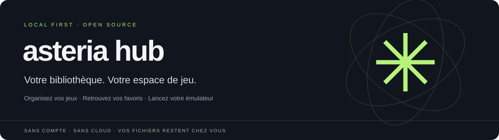
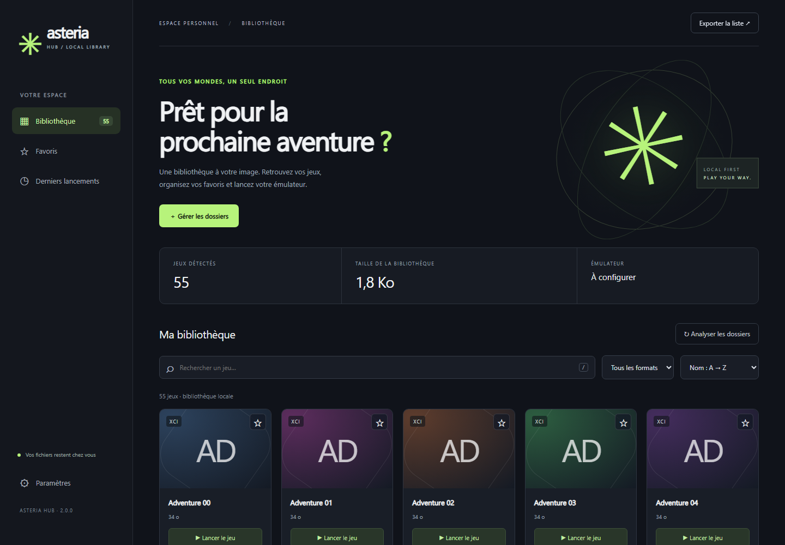
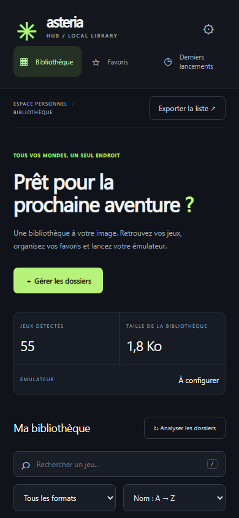

<p align="center"></p>

<p align="center">
  <a href="https://github.com/mathix03/asteria-hub/actions/workflows/ci.yml"></a>
  
  <a href="LICENSE"></a>
  
</p>

<p align="center"><a href="https://github.com/mathix03/asteria-hub/releases/latest"><b>Télécharger pour Windows</b></a> · <a href="#démarrage-sous-windows">Installation</a> · <a href="https://github.com/mathix03/asteria-hub/issues">Signaler un problème</a> · <a href="README.en.md">English</a></p>

# Asteria Hub

**Retrouvez vos jeux, organisez votre collection et lancez votre émulateur depuis une interface unique.**

Asteria Hub est une bibliothèque de jeux locale, indépendante et open source, pensée pour une utilisation avec Eden. Le projet reprend l’idée d’Eden Switch Hub avec une base portable et une distribution publique sans fichiers personnels. Aucun compte ni service distant n’est nécessaire pour utiliser l’application.

## Aperçu



<details><summary>Voir l’interface sur petit écran</summary><br></details>

*Captures réalisées avec des fichiers de démonstration synthétiques, sans contenu de jeu.*

## Fonctionnalités

- Analyse récursive de plusieurs dossiers, sans doublonner un fichier présent dans des dossiers imbriqués.
- Reconnaissance des fichiers NSP, XCI, NSZ et NRO. Leur exécution dépend des formats acceptés par l’émulateur configuré.
- Recherche insensible aux accents, filtres de format, pagination et tris par nom, taille, modification ou dernier lancement.
- Favoris conservés après redémarrage et compteur des commandes de lancement.
- Jaquettes locales : placez `Mon jeu.png`, `.jpg`, `.jpeg` ou `.webp` à côté de `Mon jeu.nsp`. Aucun téléchargement d’image n’est effectué.
- Export JSON de la bibliothèque sans chemins absolus.
- Interface adaptative, navigation au clavier, raccourci `/`, dialogues accessibles et messages d’erreur explicites.
- Aucune inscription, publicité ou télémétrie. Le serveur écoute uniquement sur `127.0.0.1`.

## Démarrage sous Windows

Téléchargez l’archive Windows depuis la page **[Releases](https://github.com/mathix03/asteria-hub/releases/latest)**, extrayez-la, puis lancez `AsteriaHub.exe`. Python n’est alors pas nécessaire. L’archive comprend les notices de licence des dépendances ; le fichier `SHA256SUMS.txt` permet de contrôler les téléchargements. Gardez sa fenêtre de console ouverte pendant l’utilisation ; fermez-la ou utilisez Ctrl+C pour arrêter le serveur.

Pour démarrer depuis le code source, installez Python 3.11 ou plus récent, ouvrez un terminal dans le dossier du projet, puis exécutez :

```powershell
py -3 -m venv .venv
.\.venv\Scripts\python.exe -m pip install -r requirements.txt
.\.venv\Scripts\python.exe main.py
```

Les lancements suivants peuvent se faire avec `launch.bat`.

Ouvrez **Paramètres**, renseignez le chemin complet de l’exécutable Eden, puis vos dossiers de jeux, un par ligne. Le bouton **Enregistrer et analyser** construit la bibliothèque. Le bouton **Lancer le jeu** transmet le fichier à l’émulateur ; il ne vérifie pas que l’émulation est ensuite réussie.

## Linux et macOS

```sh
python3 -m venv .venv
.venv/bin/python -m pip install -r requirements.txt
.venv/bin/python main.py
```

L’application Python utilise des chemins portables. Sous macOS, sélectionnez le binaire situé dans le paquet `.app`, généralement sous `Contents/MacOS`, plutôt que le dossier `.app` lui-même. Les validations locales de cette version ont été réalisées sur Windows ; la matrice CI est prévue pour Windows, Linux et macOS.

## Paramètres et dépannage

Les préférences sont stockées hors du projet : `%APPDATA%\AsteriaHub` sous Windows, `~/Library/Application Support/AsteriaHub` sous macOS, et `$XDG_DATA_HOME/asteria-hub` (ou `~/.local/share/asteria-hub`) sous Linux. La variable `ASTERIA_DATA_DIR` permet d’utiliser un autre profil. Une configuration illisible est conservée sous `settings.invalid.<date>.json` avant réinitialisation.

- **Port occupé** : utilisez `python main.py --port 8766` ou `AsteriaHub.exe --port 8766`.
- **Pas de navigateur automatique** : ajoutez `--no-browser`, puis ouvrez l’adresse affichée.
- **Jeu déplacé ou supprimé** : relancez l’analyse. Un lancement vers un fichier absent est refusé.
- **Dossier inaccessible** : vérifiez que le disque est connecté et les droits de lecture disponibles. Les avertissements apparaissent dans l’interface.
- **Paramètres perdus** : vérifiez la variable `ASTERIA_DATA_DIR` et le dossier de profil utilisé.

L’identifiant d’un jeu dépend de son chemin : déplacer ou renommer un fichier lui donne un nouvel identifiant. Favoris et historique ne sont pas automatiquement transférés dans ce cas. Les dossiers et fichiers symboliques sont ignorés pour éviter les boucles et les sorties involontaires du dossier analysé.

## Depuis Eden Switch Hub

L’application d’origine peut être conservée. Les préférences ne sont pas importées automatiquement : renseignez vos chemins dans Asteria Hub. Aucun jeu n’est déplacé ou modifié.

Cette version publique se concentre sur les fichiers locaux. Elle ne reprend pas le catalogue externe, les statuts de compatibilité non vérifiés, les recherches de ROM en ligne ou l’installation intégrée d’Eden et de clés. Aucun jeu, clé, firmware, émulateur ou binaire aria2 n’est fourni. Asteria Hub est indépendant de Nintendo et du projet Eden.

## Tests et compilation

```powershell
.\.venv\Scripts\python.exe -m pip install -r requirements-dev.txt
.\.venv\Scripts\python.exe -m pytest -q
.\.venv\Scripts\python.exe -m playwright install chromium
.\.venv\Scripts\python.exe tests/browser_smoke.py
.\.venv\Scripts\python.exe build.py
```

Sous Linux et macOS, remplacez `.\.venv\Scripts\python.exe` par `.venv/bin/python`. Pour Chromium en CI Linux, utilisez `python -m playwright install --with-deps chromium`.

Le build produit `dist/AsteriaHub.exe` sous Windows. Il inclut uniquement l’application et ses ressources statiques. Construisez sur chaque système cible si vous souhaitez distribuer un exécutable natif pour celui-ci.

Les tests utilisent des fichiers synthétiques. Ils vérifient le scan, la recherche, les filtres, la persistance, les erreurs, l’API et l’interface dans Chromium. Le lancement est contrôlé avec un processus simulé et un véritable processus Python exécutant un fichier de test. Ils ne prouvent pas la compatibilité des jeux avec Eden. La variable `ASTERIA_EXECUTABLE` permet de faire tourner le test navigateur contre le binaire compilé plutôt que les sources.

## Distribution et intégration continue

Le workflow [Tests and builds](https://github.com/mathix03/asteria-hub/actions/workflows/ci.yml) prévoit les tests sous Windows, Linux et macOS avec Python 3.11 et 3.13, un parcours navigateur sous Linux, puis la compilation et le contrôle de l’exécutable Windows. Son résultat courant est visible dans l’onglet Actions et le badge en haut de cette page.

Après compilation et validation, exécutez `python package_release.py` depuis l’environnement de développement Windows. Ce script exige un dépôt Git avec ses sources suivies : il prépare une archive des sources, une archive Windows avec les textes de licence des dépendances et le fichier `SHA256SUMS.txt`. Pour une diffusion simple, créez une Release `v2.0.0` et joignez ces archives et les sommes de contrôle. Les fichiers de `dist/`, profils personnels, clés, jeux, environnements Python et archives privées sont exclus de Git. Ne publiez pas le dossier d’origine Eden Switch Hub avec son archive d’installation.

GitHub héberge les sources et les téléchargements. Asteria Hub s’exécute sur le PC de chaque utilisateur ; GitHub Pages ne peut pas exécuter son serveur Python ni accéder aux fichiers locaux.

## Contribuer

Voir [CONTRIBUTING.md](CONTRIBUTING.md). Code sous [licence MIT](LICENSE).

Les améliorations et corrections sont les bienvenues : [proposer une fonctionnalité](https://github.com/mathix03/asteria-hub/issues/new?template=feature_request.yml) ou [signaler un bug](https://github.com/mathix03/asteria-hub/issues/new?template=bug_report.yml).

Consultez le [journal des changements](CHANGELOG.md) pour connaître le contenu des versions. Ce projet ne garantit pas la compatibilité d’un jeu avec un émulateur et n’est affilié ni à Nintendo ni au projet Eden.
